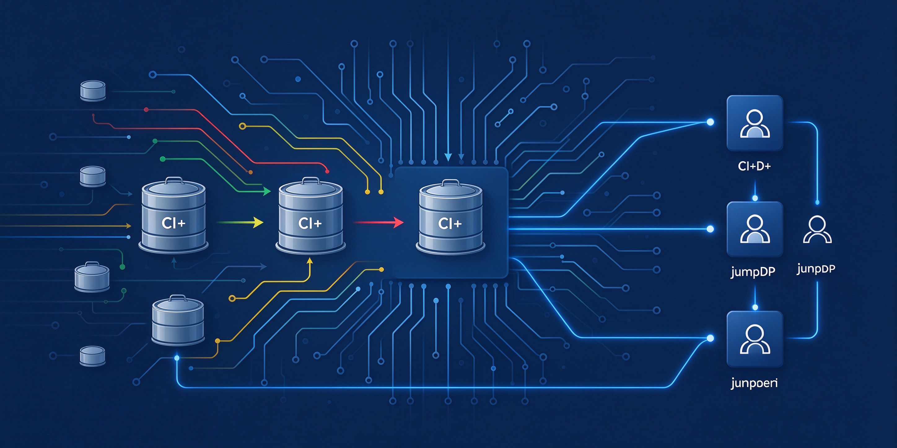

---
hide:
  - toc
---

# DevVault

**liucl**  ·  C++ / Go 系统开发手记

---

-   

    **[C++工程化实战](cpp-engineering/index.md)**

    从零搭建三平台 C++ CI/CD 流水线

    工具链 → Docker → Jenkins → CMake → 缓存 → Pipeline

-   

    **[低延迟桌面串流](desktop-streaming/index.md)**

    屏幕采集 → HEVC硬件编码 → RTP推流 → 硬件解码 → SDL/Qt上屏

    首帧≤50ms · 端到端≤100ms

-   

    **踩坑记录**

    待更新

---

## 最新文章

| 日期 | 标题 |
|------|------|
| 2026-10-16 | [采集端状态机与延迟控制](desktop-streaming/10-采集端状态机与延迟控制.md) |
| 2026-10-16 | [SDL 上屏与 Qt 嵌入](desktop-streaming/09-SDL上屏与Qt嵌入.md) |
| 2026-10-16 | [硬件编码接入 FFmpeg](desktop-streaming/05-硬件编码接入FFmpeg.md) |
| 2026-10-12 | [C++ SDK 流水线实战拆解](cpp-engineering/10-pipeline-real.md) |
| 2026-10-12 | [依赖缓存与增量构建](cpp-engineering/08-cache.md) |

---

## 联系

- **GitHub**：[github.com/liucl-001](https://github.com/liucl-001)
- **Gitee**：[gitee.com/goccoder](https://gitee.com/goccoder)
